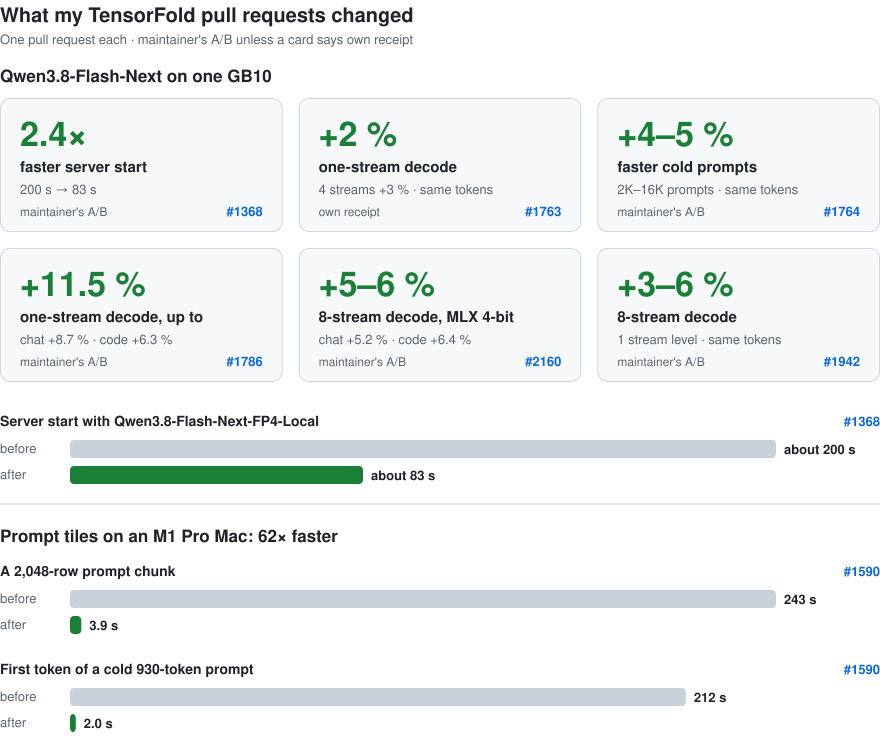

# Hi, I'm Armin

I build and tune local AI: inference engines, model recipes and dev tools, so large models run fast on hardware you
own. Current focus: NVIDIA DGX Spark (GB10).

<!-- impact:start -->
<picture>
  <source media="(max-width: 600px) and (prefers-color-scheme: dark)" srcset="assets/impact-mobile-dark.svg">
  <source media="(max-width: 600px)" srcset="assets/impact-mobile-light.svg">
  <source media="(prefers-color-scheme: dark)" srcset="assets/impact-dark.svg">
  
</picture>
<!-- impact:end -->

<!-- stats:start -->
**TensorFold** (upstream: [ashhart/TensorFold](https://github.com/ashhart/TensorFold)): **6** [pull requests merged](https://github.com/ashhart/TensorFold/pulls?q=is%3Apr+is%3Amerged+author%3AArminova) · **4,155** lines added · **9** [commits on main](https://github.com/ashhart/TensorFold/commits/main/?author=Arminova)

Counted from GitHub by [tools/refresh.py](tools/refresh.py). Pull requests: those GitHub shows as merged. Lines added: the sum of those pull requests' additions. Commits: authored by me on TensorFold's main branch; that includes #1368 and #268, which landed as my commits while GitHub shows their pull requests closed.
<!-- stats:end -->

<!-- gains:start -->
## What my pull requests changed, model by model

Each row is one pull request, in the order they landed, with the gain the maintainer or I measured for it. Every number says who measured it and links its source: the maintainer's A/B comment on the pull request, [TensorFold's changelog](https://github.com/ashhart/TensorFold/blob/c70d67bb2f260aee0adf08072a77cc580d58b6cd/CHANGELOG.md), or my own receipt in the pull request description. The rows are separate before/after runs and do not add up to one total.

### Qwen3.8-Flash-Next · CUDA engine, one GB10 (the chip in the NVIDIA DGX Spark)

Checkpoint: `nvidia/Qwen3.8-Flash-Next-FP4-Local` unless a row says otherwise.

| Pull request | What it changed | Result | Measured by | Source |
|---|---|---|---|---|
| [#1368](https://github.com/ashhart/TensorFold/pull/1368) | Experts load on several threads from the mapped checkpoint | Server start: about 200 s → about 83 s (2.4× faster†) Maintainer's alternated runs: 194–202 s → 81–88 s Replies are the same tokens; prompt and decode speed level or up to 2 % faster. | maintainer's A/B | [A/B comment](https://github.com/ashhart/TensorFold/pull/1368#issuecomment-6450647092) · [changelog](https://github.com/ashhart/TensorFold/blob/c70d67bb2f260aee0adf08072a77cc580d58b6cd/CHANGELOG.md#L920) |
| [#1763](https://github.com/ashhart/TensorFold/pull/1763) | Pending DeltaNet rows, reused lane buffers, shared expert on a side stream | Code, 1 stream: 66.1 → 67.2 tok/s (+2 %) Chat, 1 stream: 41.4 → 42.3 tok/s (+2 %) Code, 4 streams: 117.8 → 121.1 tok/s (+3 %) Chat, 4 streams: 76.3 → 78.9 tok/s (+3 %) Mean of two alternated rounds against main, greedy decode. Same tokens at 1, 4 and 16 streams. The maintainer's device checks found tokens equal on all 20 prompt rows and the new kernels bit-equal; it published no alternated A/B speed figure for this PR. | own receipt | [my receipt](https://github.com/ashhart/TensorFold/pull/1763) · [maintainer's checks](https://github.com/ashhart/TensorFold/pull/1763#issuecomment-6551765340) · [changelog](https://github.com/ashhart/TensorFold/blob/c70d67bb2f260aee0adf08072a77cc580d58b6cd/CHANGELOG.md#L558) |
| [#1764](https://github.com/ashhart/TensorFold/pull/1764) | Prompt passes do less work, same bits | Cold 2,048-token prompt: 1,645.3 → 1,702.8 tok/s (+3.5 %) Cold 8,192-token prompt: 1,744.6 → 1,825.3 tok/s (+4.6 %) Cold 16,384-token prompt: 1,748.7 → 1,839.0 tok/s (+5.2 %) The changelog says cold prompts run about 4–5 % faster with identical tokens. No cell was slower. | maintainer's A/B | [A/B comment](https://github.com/ashhart/TensorFold/pull/1764#issuecomment-6581126349) · [changelog](https://github.com/ashhart/TensorFold/blob/c70d67bb2f260aee0adf08072a77cc580d58b6cd/CHANGELOG.md#L420) |
| [#1786](https://github.com/ashhart/TensorFold/pull/1786) | Drafted rounds: first token early, n-gram table resident, deeper greedy drafts, CUDA graphs | One-stream decode, best case: up to +11.5 % Chat, temperature 0: +8.7 % Code, temperature 0: +6.3 % Chat and code, temperature 1: +4.5 % Every reply token-equal to main (0 of 20 prompt rows differ). The maintainer calls 11.5 % the best case; it is not one of the cells it lists, which are shown here. The change cost MLX 4-bit decode at eight greedy streams, which #2160 fixed. | maintainer's A/B | [A/B comment](https://github.com/ashhart/TensorFold/pull/1786#issuecomment-6622991893) · [changelog](https://github.com/ashhart/TensorFold/blob/c70d67bb2f260aee0adf08072a77cc580d58b6cd/CHANGELOG.md#L278) · [#2160 changelog (the eight-stream loss)](https://github.com/ashhart/TensorFold/blob/c70d67bb2f260aee0adf08072a77cc580d58b6cd/CHANGELOG.md#L167) |
| [#2160](https://github.com/ashhart/TensorFold/pull/2160) | Beside another open stream a greedy chain stops at 0.6 per draft; wide rounds draft it 6 deep | Flash Next MLX 4-bit with MTP Chat, 8 greedy streams, MLX 4-bit: 288.8 → 303.8 tok/s (+5.2 %) Code, 8 greedy streams, MLX 4-bit: 336.9 → 358.5 tok/s (+6.4 %) FP4, 8 greedy streams: chat / code: level (−0.1 % / −1.3 %, inside the run spread) Measured against its merge-base, which already had #1786; it recovers the eight-stream loss #1786 caused. The 1, 2 and 4 stream rows are level; each stream equals its run alone in all 720 checks. | maintainer's A/B | [A/B comment](https://github.com/ashhart/TensorFold/pull/2160#issuecomment-6646355107) · [changelog](https://github.com/ashhart/TensorFold/blob/c70d67bb2f260aee0adf08072a77cc580d58b6cd/CHANGELOG.md#L167) |
| [#1942](https://github.com/ashhart/TensorFold/pull/1942) | A shared round's DeltaNet steps in one launch each over its lanes | Aggregate decode, 8 streams: +3.0 % to +6.3 % 4 streams: +1.7 % to +3.7 % 2 streams: +0.9 % to +1.4 % 1 stream: −0.2 % to −0.4 % (the same launches as main, so level) The changelog says 8 streams decode 3–6 % faster with the same tokens. Prompts level, 0 of 20 rows differ. Measured on the rebased head 483d45853. | maintainer's A/B | [approving review with the A/B](https://github.com/ashhart/TensorFold/pull/1942#pullrequestreview-5795207877) · [changelog](https://github.com/ashhart/TensorFold/blob/c70d67bb2f260aee0adf08072a77cc580d58b6cd/CHANGELOG.md#L46) |

### LFM2.5-24B-A2B · Metal engine, Apple M1 and M2 Macs (measured on an M1 Pro)

Checkpoint: `LiquidAI/LFM2.5-24B-A2B-MLX-4bit` unless a row says otherwise.

| Pull request | What it changed | Result | Measured by | Source |
|---|---|---|---|---|
| [#1590](https://github.com/ashhart/TensorFold/pull/1590) | Prompt tiles store their matrix fragments whole instead of element by element | 2,048-row prompt chunk: 243 → 3.9 s (62× faster†) First token of a cold 930-token prompt: 212 → 2.0 s (106× faster†) 16 greedy streams together: 11–17 tok/s → 116–123 tok/s Tokens are bit-identical. The maintainer's A/B ran on an M3 Ultra and an M5 Ultra, not an M1: tokens equal and prompt speed flat there, but 16-stream greedy decode 1.8–2.3 % slower on the M3 Ultra, so the merged change applies to M1 and M2 only. The M2 was not measured. | own receipt, repeated in the changelog | [my receipt](https://github.com/ashhart/TensorFold/pull/1590) · [changelog](https://github.com/ashhart/TensorFold/blob/c70d67bb2f260aee0adf08072a77cc580d58b6cd/CHANGELOG.md#L706) · [maintainer's A/B](https://github.com/ashhart/TensorFold/pull/1590#issuecomment-6520184333) |

† computed from the two stated figures; every other percentage is as the source states it.
<!-- gains:end -->

## Recipes for one DGX Spark

| Recipe | What it is |
|---|---|
| [Nemotron-3.5-Super-VL abliterated](https://github.com/Arminova/Nemotron-3.5-Super-VL-Abliterated-Single-DGX-Spark) | NVIDIA's 120B vision-language model, uncensored, on TensorFold or vLLM; refusals from 98 % to 2 %, tasks and speed unchanged |
| [Qwen3.8-Flash-Next](https://github.com/Arminova/Qwen3.8-Flash-Next-Single-DGX-Spark-TensorFold) | 262,144-token windows, three streams, NVIDIA's public FP4-Local checkpoint |
| [DeepSeek-V4-Flash](https://github.com/Arminova/DeepSeek-V4-Flash-Single-DGX-Spark-TensorFold) | Engine patches and a Docker image for the 0731 model on a single Spark |

## Models on Hugging Face

| Model | What it is |
|---|---|
| [Nemotron-3.5-Super-VL-120B-A12B-NVFP4-abliterated](https://huggingface.co/armin1/Nemotron-3.5-Super-VL-120B-A12B-NVFP4-abliterated) | The uncensored build behind the recipe above, in NVIDIA's own tensor formats |
| [Qwen3.8-27B-NVFP4-FP8-Mixed-LH](https://huggingface.co/armin1/Qwen3.8-27B-NVFP4-FP8-Mixed-LH) | A mixed NVFP4 / FP8 quantization for single-GPU Blackwell machines, SGLang and DFlash ready ([uncensored variant](https://huggingface.co/armin1/Qwen3.8-27B-NVFP4-FP8-Mixed-LH-Heretic)) |

## Contributions to [TensorFold](https://github.com/ashhart/TensorFold)

<!-- prs:start -->
| Pull request | What it does | Status |
|---|---|---|
| [#1942](https://github.com/ashhart/TensorFold/pull/1942) | Flash Next on CUDA: a shared round's DeltaNet steps run in one launch over all its lanes | Merged 2026-11-06 |
| [#2160](https://github.com/ashhart/TensorFold/pull/2160) | Flash Next on CUDA: several greedy streams draft better, which fixes the eight-stream loss #1786 caused | Merged 2026-11-05 |
| [#1786](https://github.com/ashhart/TensorFold/pull/1786) | Flash Next on CUDA: drafted rounds send the first token earlier and draft deeper | Merged 2026-11-04 |
| [#1764](https://github.com/ashhart/TensorFold/pull/1764) | Flash Next on CUDA: prompt passes do less work | Merged 2026-11-03 |
| [#1763](https://github.com/ashhart/TensorFold/pull/1763) | Flash Next on CUDA: less repeated work when several streams decode | Merged 2026-11-02 |
| [#1590](https://github.com/ashhart/TensorFold/pull/1590) | Prompt tiles on M1 and M2 Macs | Merged 2026-10-30 |
| [#1368](https://github.com/ashhart/TensorFold/pull/1368) | Flash Next on CUDA: experts load on several threads | Landed 2026-10-27: my commit is on main, but GitHub shows the pull request closed, not merged. [maintainer: landed in 8a789e3c8, my commit kept](https://github.com/ashhart/TensorFold/pull/1368#issuecomment-6450647092) · [my commit 9dc61b23f on main](https://github.com/ashhart/TensorFold/commit/9dc61b23f4bb8b109ab417f02a3e1677a9153dcd) |
<!-- prs:end -->

All of them, open ones included: [my TensorFold pull requests](https://github.com/ashhart/TensorFold/pulls?q=author%3AArminova).

More projects and tools will appear here as I open-source them.

🤗 [Hugging Face](https://huggingface.co/armin1) · [X](https://x.com/arminxnova) · [Ko-fi](https://ko-fi.com/arminh)
